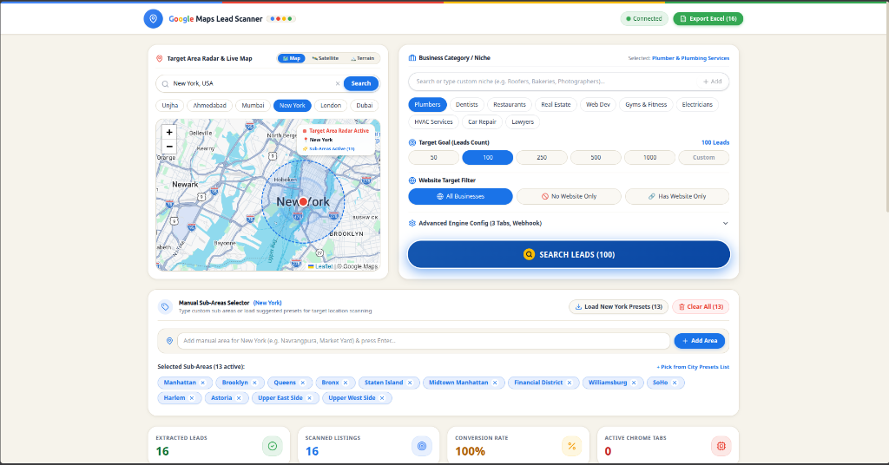
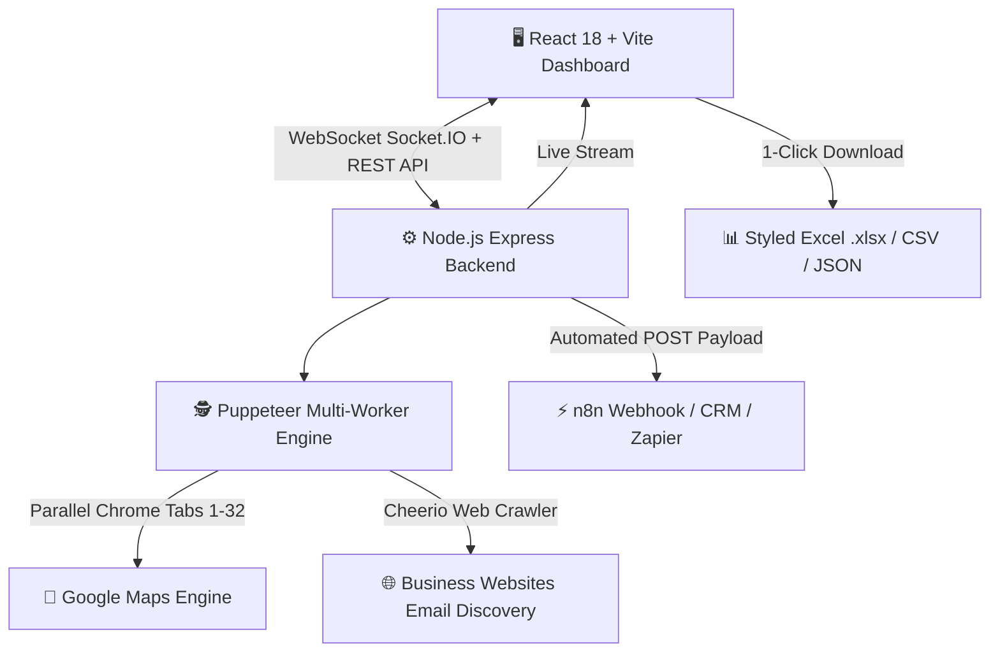

# 📍 Google Maps Lead Scanner & Intelligence Dashboard PRO

<p align="center">
  
  
  
  
  
  
  
  
</p>

<h3 align="center">
  🚀 High-Speed Multi-Worker Google Maps Lead Extractor & Real-Time Intelligence Dashboard
</h3>

<p align="center">
  An all-in-one fullstack platform designed for B2B lead generation, sales agencies, and growth marketers. Extract verified business names, sanitized phone numbers, emails, websites, physical addresses, review ratings, and coordinates directly from Google Maps in real-time — with interactive radar mapping, multi-neighborhood chunking, automated Excel export, and live n8n webhook automation.
</p>

---

## 📸 Dashboard Showcase

<p align="center">
  
</p>

<p align="center"><i>Interactive Radar Map, Niche Selection, Sub-Area Presets, Live Metrics HUD, and Multi-Worker Extraction</i></p>

---

## 📑 Table of Contents

- [✨ Key Highlights & Features](#-key-highlights--features)
- [🏗️ System Architecture](#️-system-architecture)
- [💻 Prerequisites](#-prerequisites)
- [🚀 Step-by-Step Installation Guide (PC / Mac / Linux)](#-step-by-step-installation-guide-pc--mac--linux)
- [🖥️ Running the Application](#️-running-the-application)
- [📖 How to Use - Step-by-Step Workflow](#-how-to-use---step-by-step-workflow)
- [🤖 n8n & Webhook Automation Setup](#-n8n--webhook-automation-setup)
- [⚙️ Configuration & Environment Variables](#️-configuration--environment-variables)
- [📂 Project Directory Structure](#-project-directory-structure)
- [🛠️ Troubleshooting & FAQs](#️-troubleshooting--faqs)
- [📜 Available NPM Scripts](#-available-npm-scripts)
- [🛡️ License & Disclaimer](#️-license--disclaimer)

---

## ✨ Key Highlights & Features

### 🛰️ Interactive Target Area Radar & Live Map
- **Visual Geolocation Targeting**: Built-in Leaflet radar map with customizable scan radius and instant location centering.
- **Multi-Layer Map Controls**: Toggle between standard Road Map, Satellite Imagery, and Terrain views.
- **1-Click City Presets**: Pre-configured coordinates for **New York, London, Dubai, Mumbai, Ahmedabad, Unjha**, and more.
- **Dynamic Reverse Geocoding**: Search any city or address across the globe with auto-coordinate detection.

### 🏙️ Sub-Area / Neighborhood Deep Chunking (Beat the 120-Limit)
- Google Maps traditionally truncates search results to ~120 businesses per query.
- **Intelligent Neighborhood Splitting**: Subdivides target cities into distinct sub-areas (e.g., *Manhattan, Brooklyn, Queens, SoHo, Harlem, Astoria, Upper East Side*).
- Spreads parallel worker queries across neighborhoods to **extract 10x to 50x more leads** in a single scan.

### ⚡ High-Throughput Multi-Worker Puppeteer Engine
- **Parallel Worker Tabs**: Run from **1 up to 32 concurrent worker tabs** inside an optimized browser instance.
- **Live Chrome vs. Headless Mode**: Toggle between visible interactive Chrome windows (to inspect scraping live) or stealth headless mode for server/background operation.
- **Anti-Bot & Anti-Detection Defense**: Tuned user-agent emulation, viewport normalization, smooth scrolling jitter, and resource blocking (CSS/media/fonts) for maximum throughput and minimal RAM footprint.

### 🔍 Deep Contact Extraction & Intelligent Number Formatting
- **Sanitized Phone Numbers**: Removes formatting artifacts, country dial codes, local trunk codes, and filters out invalid zip codes / postal codes.
- **Multi-Country Precision**: Automatically formats Indian standard (+91), US/Canada (+1), UK (+44), UAE (+971), and global formats.
- **Email Deep Scanning**: Automatically visits official business websites and extracts public contact emails (`contact@`, `info@`, etc.) using Cheerio and regex pattern matching.
- **Complete Business Intelligence**: Captures Business Name, Category, Phone, Email, Website URL, Star Rating, Review Count, Full Address, and Direct Google Maps Place URL.

### 🎯 Website Target Filtering
- **All Businesses**: Capture every listed company.
- **No Website Only**: Isolates businesses that lack an official website — **the #1 highest-converting prospect list for web design agencies, SEO freelancers, and digital marketers**.
- **Has Website Only**: Targets digitally established businesses for B2B SaaS and enterprise outreach.

### 📊 Real-Time Metrics HUD & Live Dashboard
- **Zero-Refresh Realtime Sync**: Connected via WebSocket (`Socket.IO`) for instantaneous UI updates.
- **Live Performance Counters**: Tracks total **Extracted Leads**, **Scanned Listings**, **Conversion Rate %**, and **Active Chrome Tabs**.
- **Individual Worker Inspector**: View real-time status and active queries per scraping tab.

### 🤖 Seamless n8n, CRM & Webhook Integration
- **Automated Webhook Dispatch**: Stream leads directly into your n8n workflow, Zapier, Make, HighLevel, Google Sheets, or custom REST API as they are discovered.
- **1-Click Webhook Tester**: Test connection to your automation endpoint directly from the frontend before launching a scan.
- **Single-Lead Dispatch**: Push individual leads to your webhook from the verified leads table with one click.

### 📁 Enterprise Data Export
- **Formatted Microsoft Excel (.xlsx)**: Clean headers, auto-adjusted column widths, and proper cell types.
- **Standard CSV & Structured JSON**: Ready for import into HubSpot, Salesforce, Apollo, or cold email tools.
- **Auto-Download**: Automatically downloads the completed spreadsheet to your downloads folder upon scan completion.

---

## 🏗️ System Architecture



### Technology Stack

| Layer | Technologies |
| :--- | :--- |
| **Frontend UI** | React 18, Vite 5, Tailwind CSS 4, Leaflet.js, Lucide Icons |
| **Realtime Transport** | Socket.IO Client, Axios |
| **Data & Spreadsheet** | ExcelJS, XLSX (SheetJS) |
| **Backend Server** | Node.js (ES Modules), Express.js, Socket.IO Server |
| **Web Scraping Engine** | Puppeteer-Core, Chromium / Google Chrome |
| **HTML Parsing** | Cheerio, Axios |

---

## 💻 Prerequisites

Before installing the project, make sure you have the following software installed on your machine:

1. **Node.js**: `v18.0.0` or higher ([Download Node.js](https://nodejs.org/))
   ```bash
   node -v
   npm -v
   ```
2. **Google Chrome** or **Chromium** browser installed:
   - **Windows**: [Download Google Chrome](https://www.google.com/chrome/) (installed in standard `Program Files`)
   - **macOS**: [Download Google Chrome](https://www.google.com/chrome/) (installed in `/Applications`)
   - **Linux (Ubuntu / Debian)**:
     ```bash
     sudo apt update && sudo apt install -y google-chrome-stable
     # OR Chromium
     sudo apt install -y chromium-browser
     ```
3. **Git** (optional, to clone repository):
   ```bash
   git --version
   ```

---

## 🚀 Step-by-Step Installation Guide (PC / Mac / Linux)

Follow these simple steps to install and run the project locally on your machine.

### Step 1: Clone or Download the Repository

Open your terminal (PowerShell or Command Prompt on Windows, Terminal on macOS/Linux) and run:

```bash
git clone https://github.com/patelhetansh/Lead-Generator.git
cd "Lead (2)"
```
*(Or navigate into your downloaded project folder).*

---

### Step 2: Install Dependencies

The project is organized into modular `backend` and `frontend` packages with a root workspace helper.

#### Option A: One-Command Fast Install (Recommended)
Run the automated installer from the project root:
```bash
npm run install:all
```
This automatically installs:
- Root orchestration packages (`concurrently`)
- Backend packages (`express`, `puppeteer-core`, `socket.io`, `cheerio`, `exceljs`, etc.)
- Frontend packages (`react`, `vite`, `leaflet`, `tailwindcss`, `lucide-react`, etc.)

#### Option B: Manual Installation (If preferred)
```bash
# 1. Install root dependencies
npm install

# 2. Install backend dependencies
cd backend
npm install
cd ..

# 3. Install frontend dependencies
cd frontend
npm install
cd ..
```

---

### Step 3: Configure Environment Variables

#### 1. Backend Configuration
Create a `.env` file in the `backend` folder:
```bash
cp backend/.env.example backend/.env
```
Open `backend/.env` in any text editor. The default port is `3001`:
```env
PORT=3001

# Optional: Custom Chrome path (Leave commented out to auto-detect!)
# CHROME_PATH=/usr/bin/google-chrome
```

#### 2. Frontend Configuration (Optional)
```bash
cp frontend/.env.example frontend/.env
```
By default, the frontend automatically detects your local server (`http://localhost:3001`) and your local network IP (for mobile access). You only need to edit `VITE_BACKEND_URL` if hosting on a remote server.

---

### Step 4: Chrome Browser Path Verification

The application **automatically detects** Chrome / Chromium in standard system paths across Windows, macOS, and Linux:

| Operating System | Default Auto-Detected Paths |
| :--- | :--- |
| **Windows** | `C:\Program Files\Google\Chrome\Application\chrome.exe`<br>`C:\Program Files (x86)\Google\Chrome\Application\chrome.exe`<br>`%LOCALAPPDATA%\Google\Chrome\Application\chrome.exe` |
| **macOS** | `/Applications/Google Chrome.app/Contents/MacOS/Google Chrome`<br>`/Applications/Chromium.app/Contents/MacOS/Chromium` |
| **Linux** | `/usr/bin/google-chrome`<br>`/usr/bin/google-chrome-stable`<br>`/usr/bin/chromium`<br>`/usr/bin/chromium-browser`<br>`/snap/bin/chromium` |

> **Note for Custom Chrome Locations:** If your Chrome executable is installed in a non-standard location, simply set `CHROME_PATH` in `backend/.env`.  
> Example for Windows:  
> `CHROME_PATH=C:\CustomPath\Google\Chrome\Application\chrome.exe`

---

## 🖥️ Running the Application

### Method 1: Single-Command Launch (Recommended)
From the root directory, execute:
```bash
npm run dev
```
This runs both the Express backend and the Vite frontend concurrently!

- **Frontend Dashboard**: Open your browser at **`http://localhost:5173`**
- **Backend API Server**: Running at **`http://localhost:3001`**

---

### Method 2: Running Services in Separate Terminals

If you prefer dedicated terminal windows for logging:

#### Terminal 1 (Backend Server):
```bash
npm run dev:backend
# OR
cd backend && npm start
```

#### Terminal 2 (Frontend Dashboard):
```bash
npm run dev:frontend
# OR
cd frontend && npm run dev
```

---

### Method 3: Accessing from Mobile / Another PC on Same Wi-Fi

The Vite development server is configured to bind to `0.0.0.0`. You can access the scanner from your mobile phone, tablet, or another computer on the same local network:
1. Find your host computer's local IP address (e.g., `192.168.1.50`).
2. Open `http://192.168.1.50:5173` on your mobile device.
3. The dashboard will automatically connect to your backend at `http://192.168.1.50:3001`!

---

## 📖 How to Use - Step-by-Step Workflow

```
[1. Select Location] ➡️ [2. Choose Category] ➡️ [3. Select Sub-Areas] ➡️ [4. Set Filters & Workers] ➡️ [5. Search Leads] ➡️ [6. Export / Automate]
```

### 1. Select Target Location & Radar Center
- Use the **Search bar** on the map (e.g., type *"New York, USA"* or *"London, UK"*), or click any of the **Quick City Badges** (*New York, London, Dubai, Ahmedabad, Mumbai, Unjha*).
- The interactive radar circle will automatically position over your target location.
- Toggle between **Map**, **Satellite**, or **Terrain** view to inspect your target territory.

### 2. Choose Business Category / Niche
- Click any of the pre-built popular business tags:
  - `Plumbers`, `Dentists`, `Restaurants`, `Real Estate`, `Web Dev`, `Gyms & Fitness`, `Electricians`, `HVAC Services`, `Car Repair`, `Lawyers`
- Or type any custom niche in the search input (e.g., *"Roofing Contractors"*, *"Solar Panel Installers"*, *"Boutique Cafes"*) and press Enter or **Add**.

### 3. Load or Customize Sub-Areas (Recommended for Maximum Leads)
- Click **"Load City Presets"** (e.g. *Load New York Presets (13)*) to populate key boroughs and neighborhoods (*Manhattan, Brooklyn, Queens, SoHo, etc.*).
- Add any custom areas or streets using the **"+ Add Area"** input.
- Multi-area scanning queries each neighborhood separately, multiplying your captured leads.

### 4. Configure Target Goal & Filters
- **Target Goal (Leads Count)**: Choose `50`, `100`, `250`, `500`, `1000`, or enter a custom target number.
- **Website Target Filter**:
  - `All Businesses`: Extract all qualified leads.
  - `No Website Only`: Filter exclusively for companies without a website (ideal for selling web development services).
  - `Has Website Only`: Filter for companies with an active digital footprint.

### 5. Advanced Engine Settings
Click **"Advanced Engine Config"** to expand:
- **Parallel Worker Tabs**: Set concurrency from `1W` to `12W` (or up to 32 tabs). Default is `3 Tabs` for balanced speed and memory usage.
- **Show Live Chrome Window**: 
  - `ON (Visible)`: Watch Chrome actively scroll, search, and parse listings.
  - `OFF (Background)`: Run completely headless in the background without UI distraction.
- **n8n Webhook URL**: Enter your webhook endpoint to automatically stream leads.

### 6. Start Scraping
- Click the large blue **`SEARCH LEADS (Target Count)`** button.
- Watch the **Live Stats HUD** update in real-time:
  - **Extracted Leads**: Total verified leads saved.
  - **Scanned Listings**: Total raw listings processed.
  - **Conversion Rate %**: Ratio of qualified leads to raw listings.
  - **Active Chrome Tabs**: Current browser workers running.
- Use **Pause** or **Stop** at any moment if you need to halt the scan.

### 7. View, Filter, and Export Leads
- Search or filter captured results in the **Captured Leads** table by phone availability, website presence, or keywords.
- Click **"Open Map"** to view any business directly in Google Maps.
- Click **"Export Excel (.xlsx)"** for a styled spreadsheet with formatted columns.
- Click **"CSV"** or **"JSON"** for direct integration with external tools.

---

## 🤖 n8n & Webhook Automation Setup

Integrate Google Maps Lead Scanner with your automated outreach and CRM pipelines using **n8n**, **Make.com**, **Zapier**, or custom webhooks.

### n8n Setup in 3 Minutes:
1. In your **n8n** canvas, add a **Webhook** trigger node.
2. Set the HTTP Method to `POST`.
3. Copy the **Production Webhook URL** (or Test URL).
4. Paste the URL into the **"n8n Webhook URL"** field under *Advanced Engine Config* in the scanner dashboard.
5. Click **"Test"** to send a mock lead payload and verify connectivity.

### Webhook Payload Schema:
Each discovered lead sends an HTTP `POST` request with the following JSON format:

```json
{
  "id": "lead_1710582910_42",
  "name": "Manhattan Plumbing & Heating Pros",
  "phone": "+1 212-555-0198",
  "email": "info@manhattanplumbingpros.com",
  "hasWebsite": true,
  "websiteUrl": "https://www.manhattanplumbingpros.com",
  "rating": "4.9",
  "reviews": "142",
  "address": "450 Lexington Ave, New York, NY 10017",
  "category": "Plumber & Plumbing Services",
  "placeUrl": "https://www.google.com/maps/place/...",
  "latitude": 40.7516,
  "longitude": -73.9754,
  "timestamp": "2026-09-16T13:30:00.000Z",
  "source": "Google Maps Lead Scanner PRO"
}
```

### Popular Automation Workflows:
- 📧 **Cold Email Campaigns**: Automatically enroll leads into Instantly.ai, Smartlead, or Lemlist.
- 📋 **CRM Sync**: Create or update contacts in HubSpot, Pipedrive, GoHighLevel, or Salesforce.
- 💬 **Instant Alerting**: Send hot leads directly to your team Slack channel or Telegram group.
- 📑 **Cloud Sheets**: Append new leads directly to Google Sheets or Airtable rows.

---

## ⚙️ Configuration & Environment Variables

### Backend Configuration (`backend/.env`)

| Variable | Type | Default | Description |
| :--- | :--- | :--- | :--- |
| `PORT` | `Number` | `3001` | Port on which the Express & Socket.IO server listens |
| `CHROME_PATH` | `String` | *(Auto-detected)* | Absolute path to the Chrome / Chromium binary |

### Frontend Configuration (`frontend/.env`)

| Variable | Type | Default | Description |
| :--- | :--- | :--- | :--- |
| `VITE_BACKEND_URL` | `String` | *(Auto-detected)* | Backend URL for API calls and Socket.IO connection |

---

## 📂 Project Directory Structure

```
Lead-Generator/
├── assets/
│   └── dashboard-preview.png     # Screenshot preview for GitHub & documentation
├── backend/
│   ├── .env.example              # Backend environment template
│   ├── package.json              # Backend dependencies & scripts
│   └── server.js                 # Multi-worker scraper engine & Express API
├── frontend/
│   ├── .env.example              # Frontend environment template
│   ├── index.html                # Vite HTML entry point
│   ├── package.json              # Frontend dependencies & scripts
│   ├── vite.config.js            # Vite bundler & reverse proxy config
│   ├── src/
│   │   ├── main.jsx              # React app mount
│   │   ├── App.jsx               # Main dashboard controller
│   │   ├── config.js             # Dynamic backend URL resolver
│   │   ├── components/
│   │   │   ├── MapSelector.jsx      # Leaflet radar map & geocoding
│   │   │   ├── CategorySelector.jsx # Niche selection & custom categories
│   │   │   ├── ScraperControls.jsx  # Controls, workers & advanced config
│   │   │   ├── SubAreasSelector.jsx # Sub-area & neighborhood manager
│   │   │   ├── LiveStats.jsx        # Real-time metrics HUD cards
│   │   │   ├── WorkerMonitor.jsx    # Parallel worker tabs inspector
│   │   │   └── LeadsTable.jsx       # Verified leads table & export tools
│   │   └── utils/
│   │       ├── excelExporter.js     # ExcelJS styled spreadsheet exporter
│   │       └── subLocationsData.js  # Global city sub-area presets
├── package.json                  # Root orchestrator & concurrently scripts
└── README.md                     # Comprehensive project documentation
```

---

## 🛠️ Troubleshooting & FAQs

### Q1: "Failed to launch the browser process / Chrome not found"
**Cause:** Puppeteer-Core cannot find a Google Chrome or Chromium executable on your computer.  
**Fix:**
1. Verify Google Chrome is installed on your PC.
2. If installed in a non-standard folder, open `backend/.env` and set the explicit path:
   - **Windows:** `CHROME_PATH=C:\Program Files\Google\Chrome\Application\chrome.exe`
   - **macOS:** `CHROME_PATH=/Applications/Google Chrome.app/Contents/MacOS/Google Chrome`
   - **Linux:** `CHROME_PATH=/usr/bin/google-chrome`

### Q2: Linux error: "error while loading shared libraries"
**Cause:** Missing system-level rendering libraries for Chromium on Debian/Ubuntu.  
**Fix:** Install the required headless browser libraries:
```bash
sudo apt-get update && sudo apt-get install -y   ca-certificates fonts-liberation libasound2 libatk-bridge2.0-0   libatk1.0-0 libc6 libcairo2 libcups2 libdbus-1-3 libexpat1   libfontconfig1 libgbm1 libgcc1 libglib2.0-0 libgtk-3-0 libnspr4   libnss3 libpango-1.0-0 libpangocairo-1.0-0 libstdc++6 libx11-6   libx11-xcb1 libxcb1 libxcomposite1 libxcursor1 libxdamage1   libxext6 libxfixes3 libxi6 libxrandr2 libxrender1 libxss1   libxtst6 lsb-release wget xdg-utils
```

### Q3: Port 3001 or Port 5173 is already in use
**Cause:** Another application or an old scanner process is occupying the port.  
**Fix:**
- Change `PORT=3002` in `backend/.env`.
- Or terminate the existing process:
  - **Linux / Mac:** `lsof -ti:3001 | xargs kill -9`
  - **Windows (PowerShell):** `Stop-Process -Id (Get-NetTCPConnection -LocalPort 3001).OwningProcess -Force`

### Q4: Google Maps stops scrolling or shows 0 leads
**Cause:** Too many parallel tabs triggering rate limiting or a broad search query.  
**Fix:**
1. Lower the **Parallel Worker Tabs** to `2 Tabs` or `3 Tabs`.
2. Ensure you have selected a specific city and enabled **Sub-Areas**. Specific localized queries yield vastly better results than generic keywords.

---

## 📜 Available NPM Scripts

From the root project directory:

| Script | Command | Description |
| :--- | :--- | :--- |
| `npm run dev` | `concurrently ...` | Runs both backend server and frontend dashboard concurrently |
| `npm run dev:backend` | `npm --prefix backend start` | Starts the Node.js Express backend server only |
| `npm run dev:frontend` | `npm --prefix frontend run dev` | Starts the Vite React frontend development server only |
| `npm run build:frontend` | `npm --prefix frontend run build` | Compiles the production frontend bundle into `frontend/dist` |
| `npm run install:all` | `npm install && ...` | Installs root, backend, and frontend dependencies in one step |

---

## 🛡️ License & Disclaimer

This project is licensed under the **MIT License**. You are free to use, modify, and distribute this software for personal and commercial applications.

### ⚠️ Disclaimer
*This tool is intended for educational, research, and legitimate sales prospecting purposes. Please adhere to Google's Terms of Service and local data privacy regulations (such as GDPR, CAN-SPAM, and CCPA) when conducting outreach to extracted contacts.*

---

<p align="center">
  <b>Built with ❤️ for Lead Generation Professionals & Growth Engineers</b><br>
  ⭐️ <i>If you found this project helpful, don't forget to star the repository!</i>
</p>
